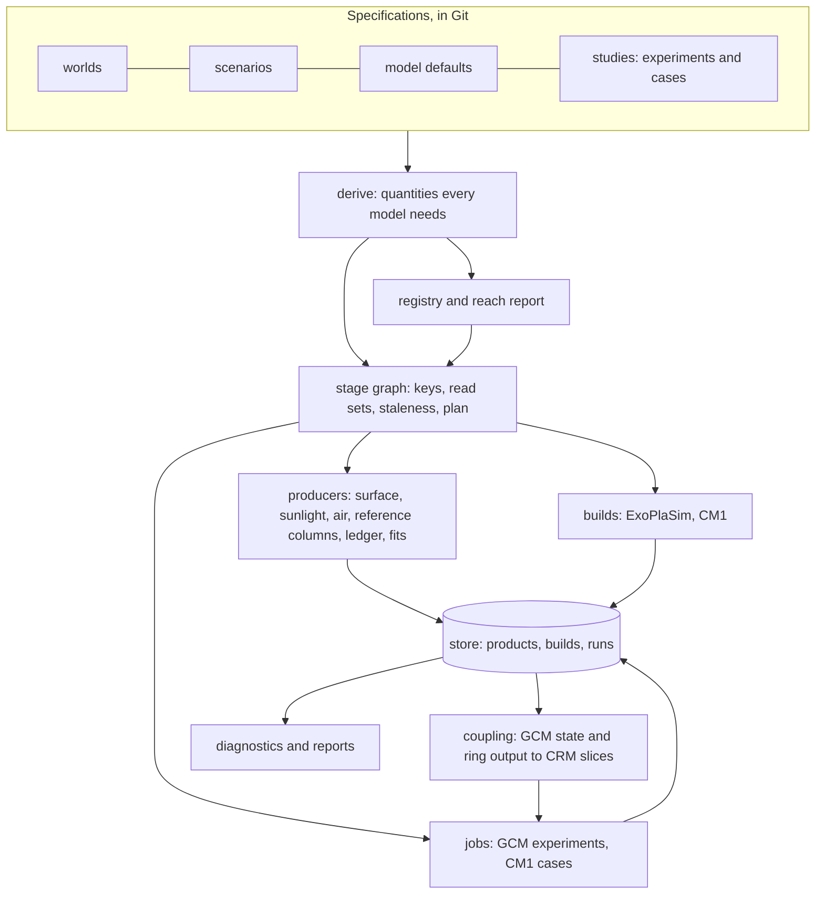

# The lab: architecture

Design draft 4 of 2026-10-18 on the `lab` branch, revised with the author's answers of 2026-10-17 and 18.
Every part of the lab described here is a proposal;
[inventory.md](inventory.md) describes what exists today, [regeneration.md](regeneration.md) what depends on
what.

## What the lab is for

A world is written down once, and ExoPlaSim and CM1, then SWAN, SWASH and other codes, are configured,
built, run, calibrated and analysed from that description. Three tasks that Terluna performs by hand
become the lab's routine work:

1. **Regeneration.** When a world, scenario or model parameter changes, the lab lists every derived input,
   calibration, build, run and analysis that depends on it, prices their rebuilding from past wall times
   and rebuilds them in order.
2. **Reach.** For any world the lab reports which of the models' Earth assumptions are repaired, which
   calibrations hold there, which need refitting and which schemes it refuses.
3. **Evidence.** Every product records its producer, its inputs and the parameter values it read, and the
   kind of evidence it is; a fit records the range of states it was fitted on as well.

The first studies, beginning with the Open Moon and with Earth beside it as the Earth control, have
Earth-like air, nitrogen and oxygen with water and modest carbon dioxide, under gravity, rotation, sunlight,
column mass and scale height far from Earth's. The adapted models exclude scenarios whose air is dominated by
CO2 or CH4, whose surface pressure reaches several bar, or whose condensables are other than water, and the
registry refuses them until a model that handles them is adapted.

The lab runs from the command line on one shared machine. Its stages are plain Python functions; under the
engine proposed in Decisions, Snakemake rules call them in the order the stage graph sets, and the same
rules can later run on a cluster.

## Principles

- **Self-contained.** What the lab uses for its own work lives in world-crafting and the lab's store: its
  specifications, adapters and case writers, run bookkeeping, analyses, builds and runs, and the data it
  reads, copied with their provenance. Terluna's files serve the tests that reproduce Terluna's runs, and
  those tests skip where Terluna is absent (the author's decision of 2026-10-17).
- **One description, with every derived value computed.** Surface gravity comes from GM, R and the spin,
  the solar day from the rotation and the year, PlaSim's model day from ExoPlaSim's own rounding rule, and
  CM1's domain length from the radius and the latitude. CM1's grid follows the scale height, its raindrop
  limits the capillary length, its soil layers the solar day and its Sun the season. A scenario's sunlight
  scale may follow its reference temperature, which the target stage meets over GCM runs. A world may state
  such a value with its basis, as Earth's seed states the standard gravity of 9.80665 m/s², and the lab
  records it beside its derivation (world_spec.md, rule 2). A study's compatibility settings may override a
  derived value to reproduce a Terluna run, and the override is recorded with every product it reaches.
- **One register for the world and its scenario.** The Open Moon charter requires one versioned register of
  pressure and composition, water, gravity, rotation and the filtered spectrum (Terluna
  `ensemble/planning/Open_Moon_Editorial_Charter_control-01.md`, E3). In Terluna these values are typed into
  about twenty files (inventory.md), and the lab's world and scenario specifications become that register.
- **A header on every product.** It records:
  - the product's schema;
  - its producer, as a code identity;
  - its inputs: upstream products by hash and external data by pin;
  - its read set: every value it used from the world, the scenario and its run's settings, by name and
    value;
  - its evidence statement and state;
  - for a fit, the envelope of states it was fitted on.

  The header extends Terluna's data-product convention (`shared/README.md`, "Data products") and the
  recording of constants by name and value in `shared/provenance.py`.
- **Computed staleness.** A product is current while its key is unchanged; the key covers its producer, its
  upstream hashes, its external pins, its read set and its environment class.
- **Refusal with a reason.** In any of five cases the lab stops the stage and names the cause:
  - an input is missing;
  - a hash differs;
  - the scenario and the run's settings lie outside a calibration's envelope, in the dimensions they fix;
  - a registry entry forbids the scheme;
  - a declared pair differs outside its delta (below).

  Outside an envelope or against a registry entry, the stage runs only on an explicit override, as the
  author decided on 2026-10-17. The override records its justification, which the lab copies into every
  downstream header, and the lab warns of it in the plan, at the start of the run and in every report built
  on its products. The other three causes stop the stage until the input, the hash or the pair is corrected.
- **Declared pairs.** A run or case derived from another names its change, as set fields or as a variant
  that its model's defaults define. The lab compares the two fully resolved input sets, build flags
  included, and refuses the pair when they differ elsewhere. Build labels stay outside the comparison: a
  label names the deployed Terluna build whose sources a case's build reproduces, in a Makefile comment
  that leaves the executable unchanged. Applied by the importer to Terluna's records of the 45° N twilight
  pair, which `lab/studies/open-moon.toml` defines as a ring and its twilight variant, the check flags the
  pair's mixed builds (defect log C8).
- **Earth in two checks.**
  - **Identity, per patch.** With its switch at its identity default, the patched model reproduces the
    released model's own Earth configuration byte for byte.
  - **The Earth control, per pipeline.** Earth's specification runs through the same derivations and
    adapters as any other world.
    - The lab's model defaults switch several repairs on for every world, the synodic Sun clock among them,
      so the pipeline's Earth run follows other code paths than the released model's. Byte identity is
      therefore required of each patch alone.
    - The pipeline's Earth run is compared with a released run configured through ExoPlaSim's own
      interface with the same air and sunlight: its global means of surface temperature, top-of-atmosphere
      net flux, precipitation and cloud cover must fall within two standard deviations of the released run's
      yearly means, a criterion the author accepted on 2026-10-17. Plan stage 8 opens with the two runs.
- **A shared machine.** Every job states its threads, memory and disk. The lab checks the load and the
  free disk before it starts one, and runs it at reduced priority.

## Concepts

| Concept | What it is | Identity | In Terluna today |
|---|---|---|---|
| World | A body: its size and mass, rotation, orbit, star and any host planet | Name and content hash | `shared/constants.json`, through `climate/gcm/boundary.py`, into `moon_gcm_configuration.json`; the year and eccentricity typed into `exoplasim_run.py:841-842` |
| Scenario | A designed or supposed state of a world: air, water, shield and sunlight scale, surface properties, outside forcings | Name and content hash | `EXPERIMENTS` (`exoplasim_run.py:85-94`), parts of `MODEL`, command-line flags |
| Model defaults | One model's settings for any world: upstream pin, patch-series state and switches, grid, physics options, output. CM1's also name variants and give lengths, times and rates at a reference state | Name and content hash | `MODEL` (`exoplasim_run.py:98-145`), `BUILDS`, `case_settings` (`cm1_run.py:1979-2035`) |
| Study | One scenario's whole chain: its GCM runs and the CM1 cases forced from them, each extending its model's defaults, with the compatibility settings that reproduce Terluna's quirks | Name and content hash | `EXPERIMENTS` and `CASES` together |
| Calibration | A fitted product, with the states it was fitted on and its residuals | Content hash | Scalars typed into `MODEL`; JSON products in `climate/results/gcm/` |
| Experiment | A GCM run in a study: its settings, calibrations, initial state and length | Its product key ("The stage graph and staleness"), which names its folder in the store | GCM run folders and their run key (`exoplasim_run.py:905-911`) |
| Case | A cloud-resolving slice in a study, forced from one of its experiments and, for a box, from a ring's day–night circulation: geometry, years, variants, CM1 settings | Its product key, as for an experiment | `CASES` (`cm1_run.py:1093-1526`), `case.json` |
| Build | An executable made from an upstream pin, a patch set, compile-time constants and flags | Hash of all four, with the compiler and its version | `cm1/build/<label>/build.json`; the patched ExoPlaSim copy on the drive |
| Delta | The declared difference between two experiments or cases: set fields, named variants | Part of the derived item | Prose ("so the pair differs in that alone") |
| Registry entry | One Earth assumption in one model: its location, what it assumes, when it matters, what repairs it | Stable id (A1, B1, …) | `notes/defect_log.md` |
| Record | What happened: segments, wall time, outputs, checks | Belongs to its run or case | `progress.json` |

A world file holds what the body is, and a scenario file what has been made of the body or is assumed for
it. The Moon's shield, its 28% seas and its air are scenario choices, so the Moon at 1.0 atm becomes a
second scenario of the same world. A run's settings are its model's defaults with the study's changes, and
the registry and the envelopes test those resolved settings.

## Components



| Component | Working module | Does | Built from |
|---|---|---|---|
| Specifications | `lab/worlds/`, `lab/configs/`, `lab/studies/` | Worlds, scenarios, model defaults and studies in TOML; `extends`, `set` and `variants` express a derived item and its delta | `EXPERIMENTS`, `MODEL`, `CASES` |
| Derive | `worldlab.derive` | Pure functions from a specification to the quantities the models need: g; Ω; the solar day; the scale height, H/R, the column mass and the Chapman horizon factor; ExoPlaSim's calendar (rotations per year, model day, steps per day, whole-day run steps); the gas mass fractions and gas constant; CM1's domain lengths and Coriolis parameters | `paper/tools/regime_calc.py`, `boundary.planet()`, arithmetic spread through the runners |
| Registry and reach | `worldlab.registry`, `lab/registry/` | Earth-assumption entries and calibration envelopes, evaluated for a world, a scenario and a run's settings into a reach report | `notes/defect_log.md`, classes (a) and (b); the paper's table of reach |
| Stage graph and store | `worldlab.stages`, `worldlab.store` | Stage definitions, product keys and headers, read-set tracking, staleness, priced plans, and the Snakemake rules that run the stages | Terluna's run key, `case.json`'s input hashes, `shared/provenance.py` |
| Model adapters | `worldlab.models.exoplasim`, `worldlab.models.cm1` | Builds, input files, namelists, runs and guards for each model | `exoplasim_run.py`, `cm1_run.py`, `cm1_elec.py` |
| Coupling | `worldlab.couple` | GCM state to CRM inputs: reference profiles, mean vertical wind, sideways forcing, surfaces along rings and in boxes; a ring's output to a box's day–night forcing | `cm1_run.py:1162-1956`, `ring_crossings.day_night_advection`, `ring_heat_budget.gcm_sideways` |
| Producers | `worldlab.produce.*`, calling `python/` | The surface grid and sunlight files, reference columns, the curved-air ledger, the gas-band, shortwave, water-continuum and longwave fits, the ice optics; the seas from the heights and the lakes from runoff; the infrared of a glow in space. Each runs on the scenario's own values, where Terluna's tools default to Earth's air and a ground albedo of 0.1 | `boundary.py`, `exoplasim_run.sunlight`, `python/climate/gcm/*`, `python/atmosphere/*`, `python/illumination/sky/*`; Terluna's `geography/atlas.py`, `geography/drainage.py` and `glow.py` |
| Jobs | `worldlab.jobs` | Each model job's wrapper: locks, segments, resume, stop files and the machine checks before it starts; chains run as Snakemake targets | Both runners' loops; the shell chains in `session-tools/` |
| Diagnostics | `worldlab.diag` | One implementation of the diagnostics every world needs: global and zonal means, energy budgets, composites by local solar time, profiles by band, GCM–CRM comparisons | `summarise_year`, `climatology.py`, the generic parts of the ring and box analyses |

Analyses particular to Terluna (comfort, named sites, the ecology and resource couplings) remain in Terluna
and read the lab's products.

## Specifications

Specifications are TOML, written by hand or by the lab's own commands and kept in Git, while products and
records are JSON written by the lab. In TOML a comment beside each value can give its source, and Python's
standard library reads the format (`tomllib`). A specification's identity is the hash of its resolved form,
computed after its `extends` chain and variants are applied and its derived values filled in, which leaves
formatting and comments out of the identity. [world_spec.md](world_spec.md) sets out the draft schema with
the Open Moon worked through.

The specifications divide by what they describe:

- **World and scenario files** hold the physical values once, for every model.
- **Each model's defaults** hold the settings only that model has, stated for any world.
- **A study** sets up one scenario's chain: its GCM runs, then the CM1 cases forced from them, each extending
  its model's defaults with the changes particular to the study. Its compatibility settings hold the quirks
  that reproducing Terluna's runs requires.

Terluna builds families of cases, such as rings at six latitudes, in loops over Python dicts
(`cm1_run.py:1124-1159`). The lab generates each family into explicit entries of a study, which can then be
read and compared one by one.

## The stage graph and staleness

A **stage** is a producer with declared kinds of input, and a **product** is one result of a stage. A
product's key is a hash of five things:

- the producer's identity: the hashes of its module and of the in-house modules it imports, with models
  identified by build hash and external tools by version;
- the upstream products' hashes;
- the pins of the external data it reads, such as HITRAN lines, TSIS-1, MT_CKD and the RRTMG tables;
- the values in its read set;
- the environment's class: Python and the major and minor versions of numpy, scipy and numba; for builds,
  the Fortran compiler and its version, and for a build at `-march=native` the CPU type it compiles for.

The full versions are recorded beside the key.

**Read sets** are declared by each stage, by name, so that a product's key follows from the specifications
before the product exists. The producer receives a tracking view of the specifications, which records each
value it reads by name and value and refuses a read outside the declaration. A derived value enters as
its value, so a consumer that reads only g stays current when GM and R change together and leave g where
it was. Terluna's `shared/provenance.py` applies this rule to its constants; the lab extends it to every
input.

**Plan.** `lab plan` computes the keys from the current specifications and compares them with the store.
It lists the stale products in the order it would rebuild them, each priced from the wall times in its
records. `lab make` then passes them to Snakemake as targets, which runs them within the machine budget.

**Running under Snakemake.** Each product's key names its output path, and a rule's inputs are its
upstream products' paths. The lab runs Snakemake with its file-time trigger alone: a step runs where its
output is missing, as a new key's is, or older than an input, and each product is write-protected once
complete, so its key remains the one test of its staleness. Since Snakemake deletes the declared outputs of
a failed step, a long run declares its record, written when the run completes, and keeps its folder
beside it; downstream stages read the folder the record names. The fixpoint loop runs inside one step,
since Snakemake's graph is acyclic.

**The test of the planner.** The dependency map in regeneration.md was worked out by hand from Terluna's
code. Before `lab make` acts on its plans, the planner's computed staleness must match the map in its
worked cases (plan.md, stage 4).

## Model adapters

Each model version has its own adapter, and a version that adds physics, such as reduced correlated-k
radiation or a deep-atmosphere core, also has its own patches and identity tests. An adapter states:

- what it needs from the derived quantities and the registry;
- how it makes a build;
- how it writes a run's input files;
- how it runs, resumes and stops;
- how its output is read into the diagnostics' variables.

**ExoPlaSim.**

- **Builds.** A build is an installed copy of ExoPlaSim 3.4.2 at a named point in the patch series. It is
  compiled for its resolution, levels and ranks, and kept in the store under its key. Terluna patched its
  shared installation with patches 01–06 and kept a second copy for 07–10 (inventory.md); in the lab each
  state of the series has a copy of its own.
- **The calendar** follows ExoPlaSim's own rule (`exoplasim/__init__.py:2609-2619`;
  `plasim.f90:1287-1302`):
  - `N_DAYS_PER_YEAR` is the year in whole days, 365 for Earth, when `rotationperiod` is 1, and otherwise
    12 · max(1, ⌊360/(12·P_rot) + 0.5⌋);
  - the model day is P_rot · N/(N − 1), and exactly one day when `rotationperiod` is 1 (`plasim.f90:1287`).

  The steps per model day, the whole-day run length, the steps per mean and the expected output count
  follow from it, replacing the values Terluna typed in for the Moon: 1,430 steps, 12 days a year and 120
  means (`exoplasim_run.py:98`). The steps per mean come from an interval in days: below a model day, the
  means a model day are the divisor of its steps whose mean lies nearest the interval, 10 means of 143
  steps for the Moon's 3 days; from a model day up, the interval takes whole model days.
- **Namelists and guards.** The namelist edits of `build_model` (`exoplasim_run.py:1010-1085`) become a
  function of the resolved inputs. The guards remain: the band split, Terluna's run key against resuming a
  changed run, free disk and the output count. A new guard checks the time step, a stated model choice,
  against the advective limit at the world's radius and the truncation with the run's largest wind, each
  model year.
- **Patch 10's solar weights.** Patch 10 writes the near-infrared weights of the TSIS-1 Sun into
  PlaSim as Fortran constants (regeneration.md, cross-dependency 13). A planned patch 11 reads them from
  the namelist, with patch 10's constants as its identity default, and the adapter computes them from the
  spectrum at the top of the air, the filter included. Until patch 11 passes its identity test (plan.md,
  stage 2), runs with ice optics on take patch 10's weights, from the unfiltered Sun.

**CM1.**

- **Builds.** Gravity, CO2 and O2 are the three values Terluna's builds compile in: core patches 01–03, 06
  and 07 and the electrified series' fall speeds read them as macros (`models/cm1/README.md`), so each world
  or air has needed builds of its own. CM1's dynamics and the Morrison scheme already take gravity from
  `set_constants` as the model starts. A planned core patch reads all three from the namelist, giving RRTMG
  and the CAPE diagnostic the run's gravity and RRTMG its CO2 and O2, and a companion patch in the
  electrified series gives the NSSL fall speeds the same gravity, so that one build of each patch set serves
  every world, as the author preferred on 2026-10-17. MYNN's shared constants need gravity at compile time
  and keep 9.81; the lab already refuses MYNN off Earth. Until the patches pass their checks (plan.md,
  stage 3), the adapter compiles the values in, and a build's key covers them with its patch set, flags and
  compiler.
- **Points in the series.** A build names how far it applies each patch series, as ExoPlaSim's builds
  name their point in theirs. The reproduction tests build at the point before the namelist patches, which
  the `open-moon` study names among its compatibility settings. Each planned patch is appended after that
  point, core 18 onward and electrified 10, and at its identity default reproduces the build without it:
  Earth's gravity and air for the namelist patches, Morrison's 2.8 mm cap, patch 08's 5–80 cm soil and
  patch 05's equinox Sun.
- **Case kinds,** as Terluna has them:
  - a ring on a circle of latitude, or on a tilted great circle;
  - a box: flat, over terrain, or over terrain with sea;
  - a window run again from a restart;
  - another case's inputs with a new build;
  - a finer box;
  - CM1's own samples.
- **Variants.** Twilight, terrain, sea and the electrified build are variants in CM1's defaults, each adding
  its patch series and the settings it needs (`lab/configs/cm1/defaults.toml`). A case names its variants,
  and those names form its declared delta.
- **Lengths, times and rates scaled with the scale height.**
  - The Rayleigh damping rate and the boundary layer's length already follow g (`cm1_run.py:2004-2005`).
  - The column width, the vertical grid, the model top, the nudging heights and the time step follow it in
    the lunar cases only through the values chosen for them. The defaults state these at the Open Moon's
    state, where Terluna's rings ran them. The adapter multiplies lengths by H/H_ref, with H = RT/(Mg) at
    the scenario's reference temperature, times by (H/c)/(H/c)_ref, with c = (RT/M)^½, and rates by the
    inverse. In the reproduction study, whose reference state the lab derives from `moon/open-moon` under
    Terluna's gravity, the factors are exactly 1 and reproduce Terluna's values; the spin term moves the
    lab's own lunar runs by 5 parts per million. At Earth's 288 K and air, with CM1's 9.81 m/s², lengths
    take 0.161, giving columns of 965 m and a 24.1 km top.
  - **Unscaled:** with the world's Sun in a case, the run length is set in the world's solar days, and the
    output, restart and nudging intervals stay in seconds. Terluna's gravity pair, which ran without a Sun,
    scaled those too (`time_scale`, `cm1_run.py:1974-2029`).
- **Raindrops, soil and the Sun.** Each follows the world through a planned patch with an identity
  default (registry B28, `cm1-soil-day`, `cm1-equinox-sun`):
  - Morrison's breakup diameter and its cap on rain's mean diameter scale as (9.81/g)^½, the capillary
    length, through the namelist's `brkup_db` and a planned patch. NSSL's two-moment rain, which the
    electrified box runs, has its explicit breakup off (`irainbreak`), and stage 3 identifies any other size
    limit it holds.
  - The slab soil's layers scale as (solar day/1 d)^½, where patch 08 fixes the lunar 5–80 cm on every
    world.
  - The Sun takes the declination of the case's season, where patch 05's stands at the equinox. Each case
    starts at its own sunrise, at an hour angle of −acos(−tan φ tan δ), and the GCM reference it is forced
    from averages a window of solar longitude around its season, where Terluna's rings averaged whole
    model years.
- **Refused schemes.** At a gravity more than 0.5% from 9.81 m/s², the registry refuses the schemes that
  hard-code Earth's gravity (`notes/cm1.md`): MYNN, the GFS EDMF and GFDL layers, P3, WSM6, Jensen–Ishmael,
  LFO and Goddard radiation. The tolerance is proposed; it passes the Earth control's 9.80665 m/s².

## Calibrations, envelopes and loops

A calibration is a product whose header also records:

- the reference model and its version;
- the columns or states it was fitted on, as ranges of surface temperature, precipitable water, column
  mass, composition, spectrum and the GCM's levels, with the model switches in force, such as ice optics;
- the fit's residuals;
- the fit's form.

The lab checks the envelope twice:

- **Before a run,** the scenario and the run's settings must fall inside it in the dimensions they fix:
  column mass, composition, spectrum, the GCM's levels and the switches in force. Outside it, the run
  waits for an explicit override (Principles).
- **After a run,** the settled state must fall inside it in every dimension, surface temperature and
  precipitable water included. Outside it, the run's products are marked "used beyond its fit", and every
  report built on them carries the warning.

The longwave and ice test (`A28_corrected_970_lw_ice`), which settles near 307 K, fails the second check.
Its longwave correction was fitted at 295 K, and Terluna's plan records that the corrected layers stray by
5–7 W/m² already at 302 K. The lab would mark the run "used beyond its fit" and keep it as a sensitivity
until the correction is refitted with ice optics on, as the author chose on 2026-10-17 (plan.md, stage 8).

Three calibrations are fitted on the GCM's own columns:

- the shortwave multipliers, on 11 columns of `A28_dim5`;
- the water continuum (`TH2OC`), on cloud-free columns at 280 and 310 K, where Terluna chose 0.004 by hand
  trials (inventory.md);
- the longwave correction, on about 2,100 cloud-free columns of `A28_corrected_970_heating`.

Each refit changes the climate that supplies the next columns, so a **fixpoint stage** runs the loop that
`notes/exoplasim.md` puts first among its improvements: run, take the columns, refit, run again.

- **Stopping.** The stage stops once the parameters and the climate each move less than stated tolerances,
  or at a stated pass limit.
- **Record.** Every pass is recorded, and the product's evidence state becomes "calibration, consistent
  after n passes" or "calibration, unconverged after n passes".
- **First use.** The first such loop is the paper's first item of next work, the longwave at the settled
  state.

A **target stage** finds the sunlight scale of a scenario that asks for it: secant steps over GCM runs move
the scale until the global-mean surface temperature meets the scenario's reference temperature, and each
run is kept as the stage's record. Terluna took the same steps by hand (regeneration.md, "Loops").

- **Stopping.** The stage averages each run's last ten model years and stops within 0.1 K or after six
  runs, recording which.
- **Nesting.** Within the fixpoint it runs first in each pass, so that the calibrations are refitted on the
  climate at the target.
- **Order.** Stage 5 builds it, and its runs wait for stage 7's job wrappers like any others.

**Lakes from runoff.** A run's surface takes the lakes routed from the runoff of a named earlier run of its
study (`lakes_from`), and the first run of a chain takes pinned lakes, so that each link is keyed and the
chain holds no cycle. A fixpoint step repeats the chain on request, until the lake area moves less than a
stated tolerance or a pass limit stops it.

## The registry of Earth assumptions and the reach report

An entry records:

- **Location:** the model, the file and line in the pinned upstream, and the form (constant, unit of time,
  geometry, fit beyond its range, latent defect).
- **Assumption:** for example g = 9.81, a solar day of 86,400 s, H/R = 0.0013, or a surface pressure below
  1,053.63 hPa.
- **Condition:** a list of tests, all of which must hold, on derived quantities, specification fields and
  the run's settings. Examples: gravity more than 0.5% from 9.81 m/s² with the MYNN surface layer, or the lowest
  level's pressure above 1,053.63 hPa. The seed in `lab/registry/earth_assumptions.toml` encodes these as
  structured tests that the lab can check and print.
- **State:** repaired, with its patch, switch and identity default; calibrated, with its stage; bounded;
  or open.
- **Action** when the condition holds and the run's settings lack the repair:
  - require the switch;
  - require a build;
  - require a refit;
  - warn, the warning copied into every product;
  - refuse.
- **Evidence:** the defect-log and verification-record entries it cites.

For a world, a scenario and a run's settings, the lab evaluates every entry into a **reach report**, which
lists:

- what is repaired;
- what runs at its identity default;
- what needs a refit;
- what draws a warning;
- what is refused.

Its first test is to reproduce the paper's table of reach (`paper/sections/reach.tex`) for the ten worlds
of `paper/data/worlds.json` as of 2026-10-17. Three of those worlds are slow rotators, which test the
Sun-clock entry across ExoPlaSim's rounding.

## Storage and records

| Where | Holds |
|---|---|
| Git (this repository) | Specifications, the registry, the design, small products (calibrations, tables and reports of a few MB at most), the records index |
| The store, at `$WORLDLAB_STORE`: a folder of the lab's own, on the research drive on this machine | `builds/<key>/`, `products/<stage>/<key>/`, `runs/<key>/`, `cases/<key>/`, `caches/` and an index of human names |

Each run and case is filed under its product key, as `runs/<key>/` and `cases/<key>/`. Terluna's names,
such as `A28_corrected_970` and `ring_45n_corrected_twilight`, become aliases of those keys. An imported or
reproduced GCM run also keeps Terluna's own run key (`exoplasim_run.py:905-911`), a hash of its configuration
and input files, which stage 2 must reproduce.

- **Links between records.** A case names its experiment by key. The importer therefore resolves Terluna's
  case records, which name a GCM run by its name and years, to keys.
- **Paths.** Paths enter keys relative to configurable roots, so the ledger takes from a root the run folder
  that Terluna's ledger hard-codes (`notes/reference_radiation.md`, section 3).

**Importing Terluna.** A read-only importer registers Terluna's GCM runs, CM1 cases and builds as records.
It takes the keys, configurations and hashes they recorded, and the patch-series state matched in
`models/exoplasim/runs.json` and `models/cm1/builds.json`. The imported records serve the reproduction tests
and the comparisons with Terluna, and the lab's own studies take their parents from runs the lab made.

## Jobs and the machine

Both runners already lock, run in segments, resume and stop on request, and the lab keeps each of these.
It adds:

- **A machine budget,** set per machine: total threads (half the cores here), passed to Snakemake as its
  cores and resources; nice 10; and a minimum of free disk and a load-average ceiling, which each job's
  wrapper checks before the job starts.
- **Thread variables set explicitly:** `OMP_NUM_THREADS`, `OPENBLAS_NUM_THREADS`, `NUMBA_NUM_THREADS`.
- **Chains as Snakemake targets,** replacing the shell scripts in `session-tools/`.
- **Disk planning before a case starts.** A 3-D box at Jura's size writes 54 GB over two lunar days.

## A session with the lab

Intended commands, to be built in plan stages 1–8:

```sh
lab reach moon/open-moon                         # what is repaired, what needs a refit, what is refused
lab new scenario moon/open-moon-0.960 --extends moon/open-moon --set sunlight.scale=0.960
lab new study open-moon-0.960 --extends open-moon --scenario moon/open-moon-0.960   # runs and cases, own keys
lab plan open-moon-0.960                         # stale products, their order and their cost
lab make open-moon-0.960                         # fits, builds, GCM runs and CM1 cases, within the budget
lab diff open-moon:A28_corrected_970 open-moon:A28_corrected_970_lw_ice   # resolved inputs that differ
lab status
```

## Decisions

**Taken by the author on 2026-10-17:**

| Decision | Choice |
|---|---|
| Home | The `lab/` directory of world-crafting, beside the verified patches, tools and notes, with the package `worldlab` |
| Self-contained | What the lab uses for its own work lives in world-crafting and its store; Terluna's files serve the reproduction tests alone (Principles) |
| Patches | Builds apply the `models/` series alone, whose patched sources match Terluna's byte for byte today (`models/check_patches.sh`, run on this branch on 2026-10-17); whether Terluna's runners then drop their string edits is Terluna's decision |
| Format | TOML specifications, with sources as comments beside values; JSON products and records, in the form of Terluna's products |
| Runs | Terluna's runs stay in its folders, where the reproduction tests and the importer read them. The lab's own runs begin once stages 2–3 have shown its inputs match Terluna's and stage 7's job wrappers hold them to the machine budget, and they are filed in its store |
| CM1 compiled once | Planned patches read gravity, CO2 and O2 from the namelist; once they pass plan stage 3, one build of each patch set serves every world (Model adapters) |
| After the 1.2 atm Open Moon | The Moon at 1.0 atm, the same body with every calibration refitted; then Mars at 1 bar, a new column and ledger inside RRTMG's range; then a slowly rotating Earth-like planet, which needs the general repairs alone |
| Outside an envelope | The lab refuses the run unless explicitly overridden, warns clearly even then, and records the override (Principles) |
| The Earth control's test | Global means within two standard deviations of the released run's yearly means (Principles) |
| The longwave correction | Refitted with ice optics on, since it was fitted with them off (regeneration.md, example d) |

**Proposed, for the author to confirm:**

| Decision | Choice | Reason |
|---|---|---|
| Engine | Snakemake schedules and runs the stages; the lab's own code computes product keys, writes headers and records, and applies the registry and envelope checks | Snakemake reruns a step when its inputs, parameters or code change, keeps jobs within thread and memory limits, prints its plan before running and can later submit jobs to a cluster, all of which the lab would otherwise write. Product keys name the output paths, so Snakemake's graph of files follows the lab's keys ("Running under Snakemake"). The author leaned against draft 2's in-house engine |
| Registry thresholds | The schemes that hard-code Earth's gravity refused beyond 0.5% from 9.81 m/s²; a ledger of the world's own column required beyond 10% from Earth's horizon air mass of 35; the thin-shell warning above H/R = 0.01; the soil-layer warning beyond 10% of the day's depth; the equinox-Sun warning above an obliquity of 5° | 0.5% passes the Earth control's 9.80665 m/s², 0.01 is about 7.5 times Earth's H/R, and 10% admits Terluna's lunar layers (`lab/registry/earth_assumptions.toml`) |
| Time-step guard | A warning where a run's largest wind passes 80% of the advective limit | Set against Terluna's runs, stable at 30 minutes, in stage 1 |
| Target stage and seasons | The target stage averages each run's last ten model years and stops within 0.1 K or after six runs; a CM1 case's GCM reference averages ±15° of solar longitude around its season | Ten years, as Terluna's ring references average; Terluna's trials stopped at 295.02 K, within 0.1 K; ±15° spans a twelfth of the year |
