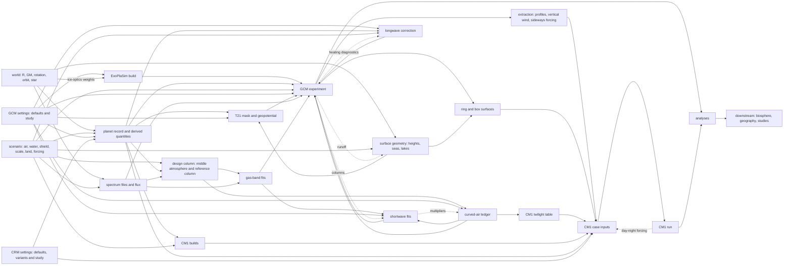

# Regeneration by parameter

When a parameter of the ExoPlaSim and CM1 work changes, the products downstream of it must be produced again,
each by a Terluna command at a stated cost, as traced by hand on 2026-10-17 from Terluna's code (f03b839) and
the surveys in [inventory.md](inventory.md). In Terluna each of those steps is started by hand or from a
session script, with the inventory's hand-copied values entered again every time. The lab's planner, which
takes the steps over, is tested against the same dependencies in stage 4 of plan.md, beginning with the four
worked examples.

## The graph

- **Dashed edges:** a run's output, or the refitted multipliers, returning to a product upstream.
- **Scenario to CM1 builds:** the lab's source for the builds' air. Terluna's builds read CO2 and O2 from a
  GCM run's record (inventory.md, hand step 9).

## Producers today

| Product | Command in Terluna, from its repository root | Cost |
|---|---|---|
| Planet record, T21 surfaces | `python -m climate.gcm.boundary` | Seconds |
| Spectrum files, flux | Written by `exoplasim_run` as each run starts | Seconds |
| Shield transmission | `python -m protection.spectra.transmission` | Seconds |
| Middle-atmosphere cases (the column's upper part, ozone) | `python -m atmosphere.middle_atmosphere.run [--only CASE]` | 7–15 min a case on 4 cores |
| Reference columns | `python -m atmosphere.radiative_convective.run [--only SWEEP]` | 1–2 min a column on 8 cores |
| Ledger | `python -m climate.gcm.twilight optics`, then `longwave`, `solve` and `ledger`, in `venvs/optics` | About 50 min on 6 threads |
| Gas-band fits | `python -m climate.gcm.plasim_shortwave gases` | Minutes |
| Radiation check on a GCM run's columns | `python -m climate.gcm.radiation_check RUN --years A B` | About 30 min on 8 cores |
| Shortwave fit | `python -m climate.gcm.plasim_shortwave fit RUN --years A B --lunar`, then copied by hand into `MODEL` | Minutes |
| Longwave correction | `python -m climate.gcm.plasim_longwave fit RUN --year 0`, on a run with heating diagnostics | About 2 min |
| CM1 builds | `python -m climate.crm.cm1_run build LABEL…` | Minutes each |
| GCM experiment | `python -m climate.gcm.exoplasim_run A28 --folder NAME --years 20 --ncpus 4 [--set …] [--start-from …]` | 2.5–4.7 min a model year |
| CM1 case | `python -m climate.crm.cm1_run setup CASE`, then `run CASE --hours H --threads T` | 1.8–12.3 h a ring and 2.3–27.2 h a box, for two lunar days |
| Analyses | `python -m climate.gcm.climatology RUN:Y`, `python -m climate.crm.ring_analysis CASE`, and the others in the inventory | Minutes each |

## Parameter by parameter

Marks: ● produced again; ○ produced again through a loop, once the GCM experiment has run again and if the
loop is closed; c kept, after a consistency or range check; — unaffected.

The product groups that head the columns:

| Column | Product group |
|---|---|
| Plan | Planet record and derived quantities, ExoPlaSim's calendar among them |
| Srf | T21 surface files |
| Sun | Spectrum files and flux |
| Col | Design column |
| Led | Ledger |
| Gas | Gas-band fits |
| SW | Shortwave fits |
| LW | Longwave correction |
| ExB | ExoPlaSim build |
| CMB | CM1 builds |
| GCM | GCM experiment |
| Case | CM1 case inputs |
| Down | CM1 runs, analyses and downstream consumers |

| Parameter | Plan | Srf | Sun | Col | Led | Gas | SW | LW | ExB | CMB | GCM | Case | Down |
|---|---|---|---|---|---|---|---|---|---|---|---|---|---|
| Radius or GM | ● | ● | — | ● | ● | ● | ●○ | ●○ | — | ● | ● | ● | ● |
| Rotation period | ● | — | — | — | — | — | ○ | ○ | — | — | ● | ● | ● |
| Solar day, where stated | c | — | — | — | — | — | — | — | — | — | c | ● | ● |
| Tilt, year, eccentricity | ● | — | — | — | — | — | ○ | ○ | — | — | ● | ● | ● |
| Star spectrum (shape) | ● | — | ● | ● | ● | ● | ●○ | ○ | ● with ice optics on | c | ● | ● | ● |
| Star total, or distance | ● | — | ● | ● | c | c | ○ | ○ | — | — | ● | ● | ● |
| Surface pressure | ● | — | — | ● | ● | ● | ●○ | ●○ | — | ● | ● | ● | ● |
| O2 or CO2 | ● | — | — | ● | ● | ● | ●○ | ●○ | — | ● | ● | ● | ● |
| Ar/N2 alone | ● | — | — | ● | ● | ● | ●○ | ●○ | — | — | ● | ● | ● |
| Surface heights (world) | — | ● | — | — | — | — | ○ | ○ | — | — | ● | ● | ● |
| Water share, seas, lakes | — | ● | — | — | — | — | ○ | ○ | — | — | ● | ● | ● |
| Land albedo | — | — | — | — | c | — | ○ | ○ | — | — | ● | ● | ● |
| Shield (filter) | ● | — | ● | ● | ● | ● | ●○ | ○ | — | c | ● | ● | ● |
| Sunlight scale | ● | — | ● | ● | c | c | ○ | ○ | — | — | ● | ● | ● |
| Infrared from space | — | — | — | — | — | — | ○ | ○ | — | c | ● | ● | ● |
| GCM resolution | — | ● | — | — | — | — | ○ | ○ | ● | — | ● | ● | ● |
| GCM levels | — | — | — | — | ● | — | ●○ | ●○ | ● | — | ● | ● | ● |
| GCM time step | ● | — | — | — | — | — | ○ | ○ | — | — | ● | ● | ● |
| A patch switch | — | — | — | — | — | — | ○ | ○ | — | — | ● | ● | ● |
| A refitted calibration | — | — | — | — | — | — | — | — | — | — | ● | ● | ● |
| CM1 grid, physics, variants, case geometry | ● | — | — | — | — | — | — | — | — | ● where a variant adds patches | — | ● | ● |

## Cross-dependencies

1. **The ledger and PlaSim's shortwave depend on each other.** The ledger computes the sunlight the curved
   air absorbs and the infrared it lets escape beyond PlaSim's flat column of the same air, and computes
   that column with PlaSim's Rayleigh and water multipliers and band split (`twilight.py:53-55, 476, 491`).
   The shortwave fit then uses the ledger's slant factors.
2. **The Rayleigh multiplier scales a coefficient that ExoPlaSim derives from the spectrum,** so a
   multiplier fitted under one spectrum is refitted under another.
3. **CM1's builds compile gravity, CO2 and O2.** O2 is held as a partial pressure, so a change of surface
   pressure moves its mole fraction and with it every build, even with the O2 partial pressure, the CO2
   ppm and the Ar/N2 ratio unchanged.
4. **The tables depend on the sunlight's total through the column's state.**
   - The design column is computed under a stated sunlight, so a new scale or a new stellar total makes
     it stale.
   - Being per unit sunlight, the ledger's terms and the gas fits change under a spectrally flat scale
     only through the column's temperature and water. The lab checks those against the states each table
     was computed on.
   - Terluna's design column still holds the earlier scale of 0.95 and 294.9 K, while the design case runs
     at 0.970.
5. **The lakes come from GCM run A's runoff,** and the GCM's surfaces are built from those lakes.
6. **A box takes its day–night forcing from a ring's output.** A change upstream of the ring therefore
   arrives at the box twice: through its own GCM extraction, and through the ring.
7. **Albedos typed apart.**
   - CM1's placeholder land row in `LANDUSE.TBL` holds its own albedo of 20%, typed apart from the GCM's 0.2
     (`cm1_run.py:1088`). In the lab both read the scenario's land albedo, so a change alters the CM1 case
     inputs and leaves the builds as they are.
   - The ledger assumes its own ground albedo of 0.1, which a change of land albedo leaves in place after a
     check.
8. **RRTMG takes the Sun's spectrum unfiltered** (defect log B9), so CM1 receives a shield as the lowered
   total in `var17`.
9. **The design temperature enters as an input.** The reference column, the ledger, the gas fits, the
   surface light and the glow are computed at a prescribed surface temperature of 294.9 K. A run that
   settles elsewhere, as the 307 K test does, leaves them describing another state.
10. **Only the GCM receives infrared from space,** through patch 06.
11. **PlaSim's levels enter three calibrations.** The ledger's GCM terms and the longwave correction are
    computed per PlaSim layer, and the offline shortwave copy runs on PlaSim's levels.
12. **The air has two Ar/N2 ratios.** The reference tools build the air with 0.0093/0.7808, and the GCM
    runner with 0.00934/0.78084. A composition change made in one recipe leaves the other behind.
13. **Patch 10 compiles in a property of the star.** It writes the weights of Ebert and Curry's four
    near-infrared bands inside PlaSim's band 2 as Fortran constants, `zew(4)` = 0.6164, 0.2283, 0.0811,
    0.0742 (`models/exoplasim/patches/10-ice-optics.patch:70`). Terluna computed them from the unshielded
    TSIS-1 spectrum.
    - With ice optics on, another star needs a new patch 10 and a new build.
    - A namelist input would remove the dependency, at the cost of a new patch version and its identity
      test.

## Loops

| Loop | Closed by | State in Terluna | In the lab |
|---|---|---|---|
| Calibrations fitted on the GCM's own columns: the shortwave multipliers and the longwave correction | Running, taking the columns, refitting and running again until both move less than a tolerance | Fitted once. The longwave correction was fitted at 295 K and runs in a test that settles at 307 K | A fixpoint stage with stated tolerances, each pass recorded |
| The ledger and the shortwave fit | Recomputing the ledger with the refitted multipliers and refitting, until both move less than a tolerance | Open: the ledger holds the multipliers from before the refit | Part of the same fixpoint |
| The sunlight scale and the design temperature | Adjusting the scale until the global mean surface temperature meets the target | By hand. Trial runs at 0.9655, 0.9685 and 0.970 gave 295.02 K at 0.970. The target is open, and new runs are held until it is set (Terluna `research/decisions.md`, 2026-10-17) | A target stage of secant steps over runs, with the runs kept as its record |
| Climate, runoff, lakes, surface | Running the drainage again on the current design run's runoff | Deferred on 2026-10-16 | A stage that calls the geography producer as an external tool, marked stale once its climate is superseded |
| The glow and the GCM's efficacy | Recomputing the glow's dimming with the efficacy the GCM returns | By hand: 0.71, then about 0.59 on the corrected radiation | A loop of two stages |
| Other gases as CO2 | Fitting the CO2 that warms as much as the other gases (755 ppm) against the reduced-gas forcing | By hand, from calibration runs | A calibration with its envelope |

## Worked examples

**(a) The sunlight scale from 0.970 to 0.960.**

- **Produced again:** the flux (`GSOL0`), the design column, the GCM experiment, the CM1 cases' `var17`, the
  CM1 runs and the analyses.
- **Checked against their envelopes and kept:** the ledger and the gas fits (cross-dependency 4). They are
  recomputed if the new column's state falls outside the states they were computed on.
- **Through the loop, when it is closed:** the shortwave and longwave fits, on the new run's columns.
- **Cost:** the column case, 7–15 min; a 20-year GCM run, 75–95 min on 4 ranks; then 1.8–12.3 h a ring.
- **In Terluna:** a new folder with `--set sunlight_scale=0.960`. A case reads the new run's flux once it
  names the run, and a build compiled for another run's air is accepted while CO2 and O2 match.

**(b) The surface pressure from 1.2 to 1.0 atm** (`moon/open-moon-1.0atm`).

- **Produced again:** the derived air and everything downstream of it:
  - ExoPlaSim's gases, `GASCON` and `ZGASW`, and an O2 mole fraction of 0.20949 against 0.17458;
  - the middle-atmosphere case, the design column, the ledger and the gas fits;
  - every CM1 build, then the GCM experiment;
  - through the loop, the radiation check, the shortwave and longwave fits and the GCM again;
  - the cases and the analyses.
- **Range check:** the 1,053.63 hPa limit of RRTMG's tables.
  - 1.0 atm (1,013.25 hPa) stays inside it.
  - The design's 1.2 atm (1,215.9 hPa) lies beyond it, and is extrapolated over the lowest 7.5 km (defect
    log B22).
- **Cost:**

  | Step | Cost |
  |---|---|
  | The column cases | 15–30 min |
  | The ledger | About 50 min |
  | Two GCM runs | About 3 h |
  | The radiation check and fits | About 40 min |
  | The rings | 1.8–12.3 h each |

- **In Terluna:** this change was run as experiment C, with the 25% seas, before the radiation was
  calibrated. Repeating it now means editing the twenty or so files into which 1.2 atm is typed.

**(c) A new body: Mars held at 1 bar** (`mars/breathable-1bar`).

- **Produced again:** everything.
- **The registry entries the reach report must raise,** some of them beyond the eleven-entry seed (A3, the
  equinox Sun, the column-mass envelope), which stage 6 adds:
  - a gravity of 3.73 m/s² against CM1's 9.81: the core patches are required, and the schemes that hard-code
    Earth's gravity are refused;
  - a solar day of 1.0275 d, 0.15% longer than the rotation: PlaSim's own clock would skip back about 1° a
    model day, which the synodic clock repairs, and each model year must still hold whole model days
    (defect log A3);
  - H/R of 0.0066 and a horizon factor of 15.5 against PlaSim's 35: a ledger of its own column;
  - a column 2.6 times Earth's: every calibration refitted;
  - a tilt of 25.19°: CM1's equinox Sun becomes a stated limit.
- **Before any of this:** the lab refuses every stage that reads an unchosen field (the world's surface
  heights, the scenario's seas, land and ozone) until it is chosen.

**(d) Ice optics switched on.**

- **Produced again:** the GCM experiment and what is forced from it.
- **For the author to choose:** whether to refit the longwave correction with ice optics on, since it was
  fitted with them off. The lab records the choice.
